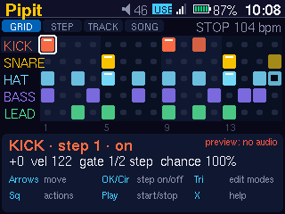
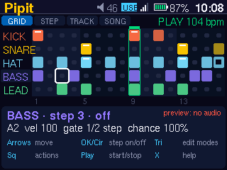
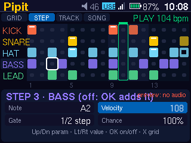
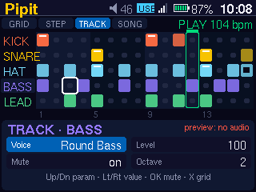
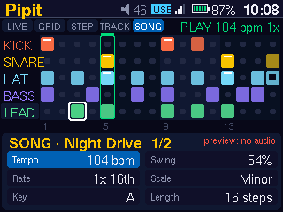
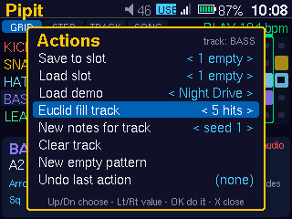

# Pipit — user manual

Pipit is a 5-lane, 16-step groove sequencer with built-in synthesized drums,
bass and lead. Find it under **Generative → Pipit**. Design and file formats:
[PIPIT-DESIGN.md](PIPIT-DESIGN.md).

 

## Opening and leaving

* Pipit opens **stopped**. On the first run it loads the *Night Drive* demo;
  after that it opens whatever you last had.
* Opening Pipit pauses the music player. Leaving with **Home** saves your
  pattern and exits. The music stays paused until you resume it in Music.
* Sound goes to the headphone output. The volume keys set the headphone
  volume as usual. **Output** in SONG mode is an extra Pipit level, and it
  starts at *Soft*.

## Screen

* **Top line:** the modes `GRID STEP TRACK SONG` (the current one is lit),
  then `PLAY`/`STOP` and the tempo.
* **Grid:** 5 lanes (KICK, SNARE, HAT, BASS, LEAD) × 16 steps, with shaded
  beats every 4 steps.
  * A lit cell is an active step. Its brightness follows velocity, and a white
    bar marks an accent (velocity 110 or more).
  * A hollow centre means the step's chance is below 100 %.
  * Steps past the pattern **Length** are dimmed.
  * `M` after a lane name means the lane is muted.
* **Playhead:** a green bar and an outlined column. **Your cursor** is a white
  box.
* **Bottom panel:** button hints in GRID. In the other modes it shows the
  parameters, and the highlighted one is the one the arrows change.

## Buttons

| Button | What it does |
|---|---|
| **Play** | Start (always from step 1) or stop. Works on every screen. |
| **Arrows** | GRID: move the cursor (wraps; hold to repeat). Other modes: Up/Down picks a parameter, Left/Right changes it (hold to repeat). |
| **OK / Circle** | Turn the step under the cursor on or off. In TRACK mode: mute or unmute the lane. |
| **Triangle** | Next mode: GRID → STEP → TRACK → SONG → GRID. |
| **Square** | Actions menu. |
| **X** | GRID: help. Other modes: back to GRID. Closes menus and help. |
| **Home** | Save and exit. |

The cursor stays where it is when you change mode. STEP and TRACK always edit
the step and lane under the cursor.

### STEP mode (the step under the cursor)

| Param | Range | Notes |
|---|---|---|
| Note | −14…+21 | Tuned lanes: scale degree, shown as a note name (for example `A3`). Drums: semitones of tuning. |
| Velocity | 1…127, steps of 8 | 110+ is an accent. |
| Gate | 1/4, 1/2, 3/4, 1, 1½, 2, 3, 4 steps | Note length. |
| Chance | 0…100 %, steps of 10 | Repeatable: the same pattern plays the same way each time. |

OK turns the step on or off here as well.

### TRACK mode (the lane under the cursor)

| Param | Range |
|---|---|
| Voice | Drum lanes choose drum voices; BASS and LEAD choose tuned voices. |
| Level | 0…127, steps of 8 |
| Mute | on/off (OK toggles it too) |
| Octave | 1…6 (tuned lanes only) |

### SONG mode (the whole pattern)

| Param | Range |
|---|---|
| Tempo | 60…180 bpm |
| Swing | 50…75 % (50 is straight) |
| Scale | minor, major, dorian, phrygian, penta minor, penta major, blues |
| Key | C…B |
| Length | 1…16 steps |
| Output | Soft / Medium / Full (saved) |

Changing the scale or key keeps the notes as scale degrees, so the melody
follows the new scale.

### Actions menu (Square)

Up/Down chooses an action, Left/Right changes its value, OK runs it, and X or
Square closes the menu. Only these actions replace your pattern, and each one
can be undone with **Undo**.

| Action | Value | Effect |
|---|---|---|
| Save | slot 1–8 | Saves the pattern. A slot that is already used asks for a second OK. |
| Load | slot 1–8 | Loads a slot. An empty slot just shows a message. |
| Demo | Night Drive, Four Floor, Dusty, Electro | Loads an editable demo groove. |
| Euclid | hits 1–16 | Spreads that many hits evenly over the current lane. |
| Notes | seed 1–9999 | New notes in the scale for the current lane's active steps. The rhythm is kept, and the same seed always gives the same notes. |
| Clear | | Clears the current lane. |
| New | | Starts an empty pattern with the default kit (the tempo is kept). |
| Undo | | Reverts the last action (one level). |

## Voices

All sounds are synthesized in real time; there are no samples.

| Voice | Kind | Use |
|---|---|---|
| kick.deep, kick.tight | kick | KICK |
| snare.crack, clap | snare, clap | SNARE |
| hat.closed, hat.open | hat (closed and open choke each other) | HAT |
| bass.round, bass.acid | mono synth with filter and glide | BASS |
| lead.pluck | plucked string | LEAD |
| lead.bell, lead.keys | FM | LEAD |
| lead.square | 4-voice synth | LEAD |

Voices are defined in `/data/zpod/apps/pipit/voices/default.toml`, and
Pipit checks the file when it opens. A screen for loading other voice banks
is planned but **not available yet**.

## Demo grooves

| Demo | Tempo | Key | Swing | Voices |
|---|---|---|---|---|
| Night Drive | 104 | A minor | 54 | kick.deep, snare.crack, hat.closed, bass.round, lead.pluck |
| Four Floor | 122 | D minor | 52 | kick.tight, clap, hat.open, bass.acid, lead.bell |
| Dusty | 88 | E dorian | 62 | kick.deep, snare.crack, hat.closed, bass.round, lead.keys |
| Electro | 112 | F phrygian | 50 | kick.tight, snare.crack, hat.closed, bass.acid, lead.square |

## Files

These are in `/data/zpod/appdata/pipit/`:

* `current.toml` is the working pattern. It is saved 2 s after a change and
  when you exit.
* `slot-1.toml` … `slot-8.toml` are your saved patterns.
* `output` is the output level.

Patterns are plain TOML (format in the design doc). You can copy them off the
device or edit them on a computer. A file with a mistake is refused with a
message, and your current pattern stays.

## Limits

* Patterns have 1 to 16 steps, 5 lanes, a fixed lane order, and a single
  pattern (there is no chaining yet).
* There is no live recording, no MIDI, and no sample playback.
* Pipit takes over the audio output: it cannot play at the same time as Music
  or other audio apps.
* Undo keeps only one level, and it covers only the Actions menu. Direct edits
  are not undone.

## Measurements

The tests run on every build (`cargo test -p zpod-seq -p zpod-voices -p
zpod-pipit`). They cover timing, swing, no drift, every note ending, stop,
voice mapping, the file checks and navigation.

The offline demo render (Mac) peaks between −2.3 and −3.6 dBFS, with RMS
between −18.7 and −20.4 dBFS, no samples over the ceiling, and DC about 0.

Device CPU (Pi Zero W): not measured yet. Run `pipit --bench 10` on the
device to measure it (as the zpod user). The command prints the render
CPU % for each demo and fails if a demo goes over 70 %.
