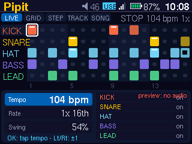
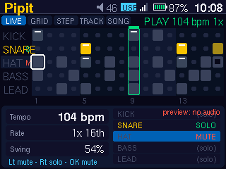
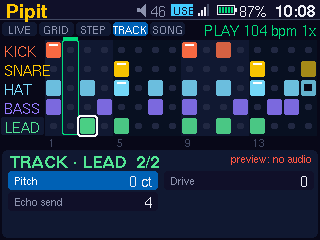
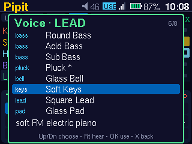
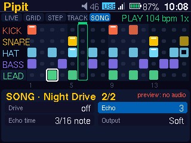
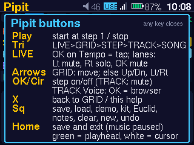

# Pipit — user manual (0.2)

Pipit is a pocket groove box. It has 5 lanes (KICK, SNARE, HAT, BASS, LEAD)
of up to 16 steps, and 20 synthesized voices. A LIVE screen gives you tempo,
tap tempo, beat rate and mute/solo. You can also shape each lane with
Tone/Decay/Pitch/Drive macros and a ping-pong echo. Find it under
**Generative → Pipit**. Design and file formats:
[PIPIT-DESIGN.md](PIPIT-DESIGN.md).

 

## Opening and leaving

* Pipit opens **stopped**, on the **LIVE** screen with Tempo selected.
* On the very first run it loads the *Night Drive* demo. After that it opens
  whatever you last had.
* Patterns saved by Pipit 0.1 load unchanged. The new settings get neutral
  defaults: rate 1×, no macros, no echo, no drive, no solo.
* Opening Pipit pauses the music player. **Home** saves your pattern and
  exits. The music stays paused until you resume it in Music.
* Sound goes to the headphone output, and the volume keys work as usual.
  **Output** (SONG page 2) is an extra Pipit level that starts at *Soft*.

## Screen

* **Top line:** the modes `LIVE GRID STEP TRACK SONG` (the current one is
  lit). Then the transport state, the tempo and the rate, for example
  `PLAY 104 bpm 1x`. This line is always visible.
* **Grid:** 5 lanes × up to 16 steps, with beats shaded.
  * A lit cell is an active step. Its brightness follows velocity, and a white
    bar marks an accent (velocity 110 or more).
  * A hollow centre means the step's chance is below 100 %.
  * Steps past **Length** are dimmed.
  * `M` after a lane name means muted; `S` means soloed.
  * Lanes silenced by somebody else's solo are drawn dim.
* **Playhead:** a green bar with an outlined column. **Your cursor** is a
  white box.
* **Bottom panel:** what the arrows change on the current screen.

## Buttons

| Button | What it does |
|---|---|
| **Play** | Start (always from step 1) or stop. Works on every screen, in menus and in the voice browser. |
| **Triangle** | Next mode: LIVE → GRID → STEP → TRACK → SONG → LIVE. |
| **Arrows** | GRID: move the cursor (wraps; hold to repeat). Elsewhere: Up/Down picks a row, Left/Right changes it. |
| **OK / Circle** | Acts on the selected thing (see each mode). It never changes tempo or mutes by surprise. |
| **Square** | Actions menu. |
| **X** | LIVE and GRID: help. Other modes: back to GRID. Closes menus, help and the browser. |
| **Home** | Save and exit. |

The arrows select and OK acts. There are no button chords.

### LIVE (performance)

| Row | Left / Right | OK |
|---|---|---|
| **Tempo** | −1 / +1 bpm (hold to repeat), 60…180 | **Tap tempo** |
| **Rate** | slower / faster beat division | – |
| **Swing** | 50…75 % | – |
| **KICK … LEAD** | Left = mute, Right = solo. The other direction goes back to *on*. | mute / unmute |

* **Tap tempo:** select Tempo and press OK on the beat.
  * From the second tap on, the tempo is the average of the last 4 intervals.
  * Presses under 120 ms apart are ignored (contact bounce or a double press).
  * A pause over 2 s starts a new count.
  * The first tap only shows a hint. The result is held to 60…180 bpm.
* **Rate** is the beat division. The pattern and tempo stay the same.

  | Rate | Steps per beat | Feel |
  |---|---|---|
  | `1/2x 8th` | 2 | half speed |
  | `1x 16th` | 4 | normal |
  | `2x 32nd` | 8 | double speed |
  | `3:2 16tr` | 6 | sixteenth triplets; swing is ignored (shown "off") |

* **While playing:** a tempo or rate change takes effect from the next step.
  Notes that are already sounding still end on time, and nothing jumps back.
  The response time is about 0.1 s (audio pipe plus DAC buffer).
* **Mute and solo:**
  * When any lane is soloed, only soloed lanes play.
  * Lane states change only on a button press, never on key repeat.
  * Muting a lane mid-note never leaves a stuck note: the note that is
    sounding still gets its note-off.
  * Mute and solo are saved with the pattern.
* Up/Down on a lane row also selects that lane for STEP and TRACK.

### GRID

Arrows move the cursor, and OK turns the step under it on or off.

### STEP (the step under the cursor)

| Param | Range | Notes |
|---|---|---|
| Note | −14…+21 | Tuned lanes: scale degree, shown as a note name. Drums: semitones of tuning (tune toms per step). |
| Velocity | 1…127, steps of 8 | 110+ is an accent. On drums, velocity changes the tone as well as the level (see Voices). |
| Gate | 1/4…4 steps | Note length. |
| Chance | 0…100 % | Repeatable: the same pattern plays the same way each time. |

### TRACK (the selected lane): two pages

 

The title shows `1/2` or `2/2`; Up/Down scrolls through both pages.

| Param | Range | Notes |
|---|---|---|
| Voice | **OK opens the voice browser**; Left/Right steps through voices directly | Drum lanes list drum voices; BASS/LEAD list tuned voices. |
| Level | 0…127 | |
| Mute | on/off | OK also toggles it. |
| Octave | 1…6 | Tuned lanes only. |
| Tone | −10…+10 | Darker / brighter: filter cutoff ×2^(t/6), plus click/brightness. |
| Decay | −10…+10 | Shorter / longer: decay and release ×2^(d/6). |
| Pitch | Drums: −12…+12 **semitones**. Tuned: −50…+50 **cents** in steps of 5 | Fine tuning on tuned lanes, so the melody stays in key. |
| Drive | 0…10 | More saturation. |
| Echo send | 0 (off)…10 | How much of this lane goes into the echo. |

Macros apply from the next note.

### Voice browser

In TRACK, select **Voice** and press OK.

* The list is grouped by category (kick, tom, snare, clap, hat, perc / bass,
  pluck, bell, keys, lead, pad), with a one-line description. `*` marks the
  current voice.
* **Up/Down:** move. Selecting does **not** make a sound.
* **Right:** *hear it*. Plays one short note of the voice with this lane's
  macros, on a separate audition channel, over the pattern if it is playing.
* **OK:** use the voice on this lane. **X / Square / Left:** cancel and keep
  the old voice.

### SONG (whole pattern): two pages

 

| Param | Range |
|---|---|
| Tempo | 60…180 bpm (same as LIVE) |
| Swing | 50…75 % |
| Rate | as in LIVE |
| Scale | minor, major, dorian, phrygian, penta minor, penta major, blues |
| Key | C…B |
| Length | 1…16 steps |
| Drive | 0 (off)…10: a soft saturator on the whole mix, before the limiter |
| Echo | 0 (off)…10: echo return level |
| Echo time | 1/8, 3/16, 1/4, 3/8 note (follows tempo) |
| Output | Soft / Medium / Full (saved) |

The echo is ping-pong (left, then right), with fixed feedback and damping, so
it always dies away. Changing the echo time fades the echo out, clears it
gradually and fades back in, so there is no glitch or CPU spike.

### Actions menu (Square)

Up/Down chooses an action, Left/Right changes its value, and OK runs it.
Only these actions replace things, and **Undo** reverts the last one.

| Action | Value | Effect |
|---|---|---|
| Save | slot 1–8 | Saving over a used slot asks for a second OK. |
| Load | slot 1–8 | |
| Demo | Night Drive, Four Floor, Dusty, Electro, Boom Trip | Loads an editable demo. |
| **Drum kit** | Deep, Tight, Boom, Toms, Soft | Sets the KICK/SNARE/HAT voices together and resets their macros. Steps are kept. |
| Euclid | hits 1–16 | Spreads hits evenly over the current lane. |
| Notes | seed 1–9999 | New scale notes for the lane's active steps (seeded, repeatable). |
| Clear | | Clears the current lane. |
| New | | Empty pattern with the default kit. |
| Undo | | One level. |

| Kit | KICK | SNARE | HAT |
|---|---|---|---|
| Deep | kick.deep | snare.crack | hat.closed |
| Tight | kick.tight | clap | hat.closed |
| Boom | kick.boom | snare.rim | shaker |
| Toms | tom.low | tom.high | hat.open |
| Soft | kick.deep | snare.soft | shaker |

### Help

X on LIVE or GRID shows the button summary.

## Voices

All 20 voices are synthesized in real time from numbers in
`/data/zpod/apps/pipit/voices/default.toml`. There are **no samples**, so
there is nothing to license; the sound designs are original to this project.

| Category | Voices |
|---|---|
| kick | kick.deep, kick.tight, kick.boom (long sub) |
| tom | tom.low, tom.high (tune per step with Note) |
| snare / clap | snare.crack, snare.rim, snare.soft, clap |
| hat / perc | hat.closed, hat.open (they choke each other), shaker |
| bass | bass.round, bass.acid (glide), bass.sub |
| pluck / bell / keys / lead / pad | lead.pluck, lead.bell, lead.keys, lead.square, pad.glass |

**Velocity on drums** changes more than loudness:

* **Kick:** a harder hit gives a deeper pitch sweep and a brighter click.
* **Snare:** a harder hit opens the noise filter and adds a short "snap"
  layer.
* **Hat and clap:** a harder hit is brighter.

The hat's metallic partials are band-limited (polyBLEP), so high hats do not
alias into the audible range.

## Demo grooves

| Demo | Tempo | Rate | Key | Voices |
|---|---|---|---|---|
| Night Drive | 104 | 1x | A minor | kick.deep, snare.crack, hat.closed, bass.round, lead.pluck (echo on lead) |
| Four Floor | 122 | 1x | D minor | kick.tight, clap, hat.open, bass.acid, lead.bell |
| Dusty | 88 | 1x | E dorian | kick.deep, snare.crack, hat.closed, bass.round, lead.keys |
| Electro | 112 | 1x | F phrygian | kick.tight, snare.crack, hat.closed, bass.acid, lead.square |
| Boom Trip | 84 | 3:2 | G penta minor | kick.boom, snare.rim, shaker, bass.sub, pad.glass (12 steps, echo on snare) |

## Files

These are in `/data/zpod/appdata/pipit/`:

* `current.toml` is the working pattern. It is saved 2 s after a change and
  on exit.
* `slot-1.toml` … `slot-8.toml` are saved patterns.
* `output` is the output level.

Patterns are plain TOML, version 2 (the format is in the design doc).

* Version 1 files from Pipit 0.1 still load. They are rewritten as version 2
  the next time Pipit saves them; nothing is dropped.
* A file with a mistake is refused with a message, and your current pattern
  stays.

## Limits

* One pattern of 1–16 steps and 5 lanes in a fixed order. There is no
  chaining, live recording or per-step parameter locks yet.
* There is no MIDI yet; it is planned (see the design doc).
* Pipit takes over the audio output: it cannot play at the same time as
  Music or other audio apps.
* Undo has one level and covers the Actions menu only.

## Measurements

Device: Pi Zero W, test6, core 0.11.0, Pipit 0.2.0, 2026-11-07, 21:20–21:30
PST. These are measurements only; they say nothing about how good it sounds.

| Check | Result |
|---|---|
| `pipit --bench 10` (offline render, 5 demos + Night Drive with drive, echo and every send at maximum) | 12.1–21.4 % of one core (worst: Boom Trip); full FX 15.6 %. The limit is 70 %. |
| `pipit --selftest 6 N` (real DAC, Soft, each of the 5 demos) | 0 ALSA underruns and 0 pipe write errors for every demo; render CPU 17.8–30.9 % |
| `pipit --xrun-test` (silence, one deliberate 1 s stall) | 1 underrun counted, so the counter works |
| Opened from the app manager and left stopped for 8 s | pipit about 7 % CPU, aplay about 0 %; 0 underruns, 0 write errors while running |

* **Subnormal fix:** Pipit 0.1 spent most of its CPU on subnormal floats.
  These are decayed click, snap and echo tails that the Pi Zero's FPU
  processes about 100× more slowly. Zeroing them once they are below
  −180 dB cut Night Drive from 44.6 % to 14.9 %, and a long-tailed kick
  from 49 % to 10 %.
* **Two counters:** music-core now reads aplay's own "underrun" reports, so
  real ALSA underruns are counted separately from failed pipe writes.
  * `zpod-app stop` signals the whole process group, so aplay quits first.
    The `xruns=N` music-core logs after a stop come from that shutdown.
  * Pipit's own exit line gives the counts from *before* the stop.
* **Offline render (host):** per demo, peaks are −2.3 to −4.9 dBFS and RMS is
  −17.1 to −20.3 dBFS, with 0 overs, DC about 0, and no voices left after
  Stop. Drums soloed: peaks −3.8 to −6.0 dBFS.
* **Hat aliasing:** the alias-to-harmonic energy ratio of one partial is
  −31.9 / −29.5 dB with polyBLEP, against −16.8 / −13.8 dB for a naive
  square at 1092 / 2184 Hz.
