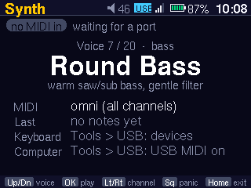

# Synth: the ZPOD as a MIDI sound module

**M1 in test7.** `synth` (Generative > Synth) plays one selectable voice
from the Pipit voice bank (`zpod-voices`, 20 voices) from any MIDI input.



## Using it

| Key | Action |
|---|---|
| Up / Down | voice (saved) |
| OK | audition: play a short phrase on the ZPOD itself |
| Left / Right | MIDI channel: omni, 1..16 (saved) |
| Square | panic (all notes off) |
| Home | exit (all notes end) |

Settings: `/data/zpod/appdata/synth/synth.conf`

```
# ZPOD Synth settings
voice = "bass.acid"     # a voice id from the bank; unknown = first tuned voice
channel = 0             # 0 = omni, 1..16
```

## MIDI inputs

The synth opens **every** rawmidi port it finds (`/dev/snd/midiC*D*`, read
only), polls them, and rescans every 2 s, so ports can come and go. It reads
from two kinds of port:

1. **From the computer** (ZPOD = USB device). Tools > USB > **USB MIDI with
   computer** turns it on (off by default). The USB link then has USB
   Ethernet (NCM) and a class-compliant MIDI function with **2 in + 2 out
   cables**. The computer sees a "ZPOD" MIDI device next to the network link.
   - Cable 1 carries notes, cable 2 is a spare (clock, a second part later).
   - The synth reads cable 1 (rawmidi subdevice 0). Cable 2 is not read in M1.
   - Switching it restarts the USB link (1-2 s; SSH over USB reconnects).
   - The setting lives in `/data/zpod/usb-midi.txt` (`midi=on|off`), set with
     `zpod-usb-role midi on|off`. It wins over a `midi=` line in
     `/boot/firmware/zpod-usb.txt`.
2. **A USB MIDI keyboard or controller** (ZPOD = USB host: Tools > USB > Use
   USB for devices, an OTG adapter or a hub). `snd-usb-audio` makes it a
   rawmidi port and the synth picks it up within 2 s.

Parser (`zpod-midi::input`): running status, realtime bytes anywhere
(including inside SysEx), SysEx skipped, Note On velocity 0 = Note Off,
RPN 0 (pitch-bend range) decoded, data bytes without a status ignored.

Handled in M1: Note On/Off, pitch bend (applied to **new** notes only),
bend range (RPN 0), All Sound Off (CC 120), All Notes Off (CC 123) and
System Reset (panic). Ignored: CC other than the panic set, program change,
aftertouch, clock and transport. A port that disappears ends all notes.

## Offline checks

- `synth --render-test`: renders a phrase with no display or audio device and
  checks that it is audible and that every note releases (used under
  `qemu-arm` for the ARMv6 build).
- `cargo test -p zpod-synth -p zpod-midi` (engine and parser tests).
- `sh tools/sim/labs/run.sh` (simulator screenshots).

## Shared realtime contract (ZPOD apps and Pi Lab)

Pi Lab and the ZPOD can share the Rust audio core if both keep to this
contract. It is what `zpod-music-core`, `zpod-voices`, `zpod-seq` and
`zpod-midi` already do; a change to it is a version bump of the contract.

| Item | Contract v1 |
|---|---|
| Audio format | 44 100 Hz, stereo, S16_LE interleaved at the sink; f32 inside |
| Period | 256 frames (5.8 ms); sink buffer 3 periods (~17 ms) |
| Render callback | `fn(&mut [i16], frames) -> bool`, called once per period on the audio thread; **no allocation, no locks, no IO, no syscalls that can block** |
| Control in | bounded SPSC queues, allocated once; full = drop + count, never block the render side |
| MIDI in | `zpod_midi::input::InMsg` (channel 1..16, note 0..127, bend -8192..8191, `BendRange` from RPN 0), parsed on a reader thread |
| MIDI out | `zpod_midi::Router` on the render side + worker thread (notes always end: retrigger off-before-on, panic on stop/exit/route change) |
| Voices | `zpod_voices::Bank` ids are stable strings; an unknown id falls back, never fails |
| Threads | audio thread first priority; UI and IO threads may stall without audible effect |
| Platform split | Linux-only calls behind `cfg(target_os = "linux")`, so the library crates test on the Mac |

The A/B question (should Pi Lab use the ZPOD A/B layout): the `.zab` bundle
format is documented in [AB-UPDATES.md](./AB-UPDATES.md). It is board-keyed
(`board=pi0w`), hashed and **unsigned**; signing is the next step before it
is shared with another device.

Licensing: the ZPOD crates stay MIT for now. Paul's rule for code that must
interwork with Pi Lab (dual licensing) is not settled; nothing here changes
until it is.

## Trillium as console (plan: config v1 variants)

Trillium (the Trill-based controller) is the intended console and manager
for the synth: it sends notes, and later sends **configuration**. Plan, not
built in test7:

- A versioned file, the same strict style as `midi.toml`:
  ```toml
  format = "zpod-synth"
  version = 1
  voice = "bass.acid"
  channel = 0            # 0 = omni
  bend_range = 2         # default until an RPN 0 arrives
  [[variant]]            # named presets Trillium can switch between
  name = "bass"
  voice = "bass.acid"
  channel = 1
  [[variant]]
  name = "pad"
  voice = "pad.glass"
  channel = 2
  ```
  Every key required, unknown keys rejected, any error = keep the last good
  settings (as `zpod-midi` does). M1's two-line `synth.conf` is read as a v0
  file and upgraded when saved.
- Transport: Program Change on cable 2 selects a variant; a SysEx with a
  ZPOD manufacturer-ID placeholder (non-commercial 0x7D) carries a whole v1
  file. Both are receive-side only and need no new permissions.
- Management (copying variants and voice files to and from the ZPOD) goes
  over the existing SSH/rsync link, not MIDI.

## Follow-up (M2+)

- Several voices at once (one per channel = multitimbral), cable 2 read.
- Pitch bend on sounding notes, mod wheel and sustain (CC 1, CC 64).
- Measured latency (MIDI in to DAC) with a loopback.
- MIDI out of the synth's own audition to the computer.
