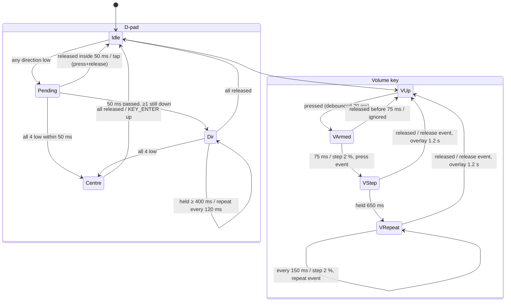
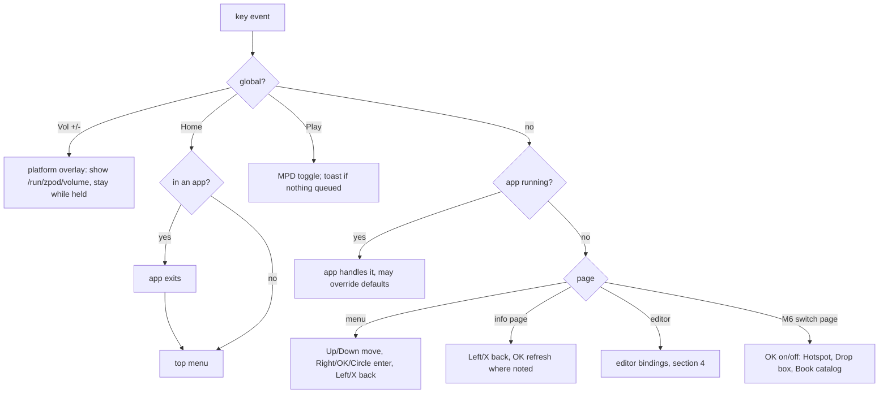
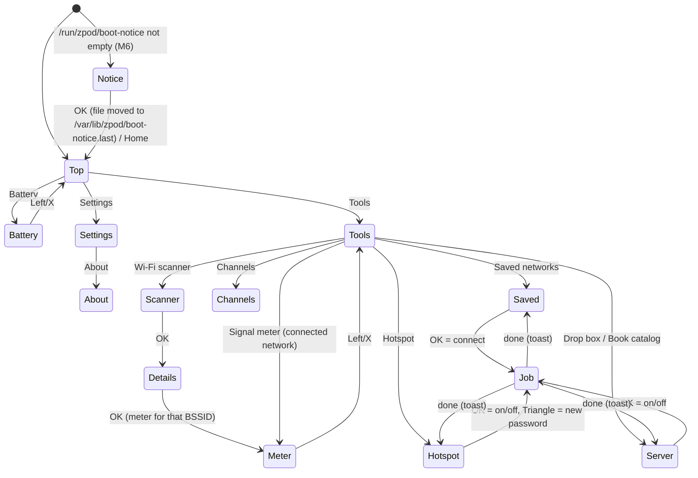

# ZPOD buttons and menus (M4/M5/M6 launcher)

This is the reference for how the ZPOD buttons behave in the M4 Rust launcher
and its apps. The GPIO-to-key map is in [../BUTTONS.md](../BUTTONS.md).
Code: `apps/crates/zpod-core/src/nav.rs` (shared navigation),
`apps/crates/launcher/src/menu.rs` (menu tree),
`apps/crates/zpod-core/src/volume.rs` (volume overlay),
`overlay/usr/lib/zpod/zpod_buttons.py` (GPIO → keys, volume).

Status labels: **M4** = in the M4 candidate; **M5** = in v0.6.0-m5;
**M6** = in v0.8.0-m6-rc1; **next** = planned for the release after M6; **future** = wanted but not
committed.
Hardware labels: **confirmed** = measured on Paul's ZPOD; **inferred** = from
vendor files or wiring, not yet proven.

## 1. Rules (all screens)

| Button | Key | Role | Scope |
| --- | --- | --- | --- |
| Home | `KEY_HOME` | go to the **top launcher menu** (closes the app) | global |
| Play/Pause | `KEY_PLAYPAUSE` | **play / pause music** (MPD) | global |
| Vol + / − (side) | `KEY_VOLUMEUP/DOWN` | change the volume; one overlay for every screen | global |
| Up / Down | `KEY_UP/DOWN` | move the selection; repeat while held | default |
| Right, D-pad centre, Circle | `KEY_RIGHT`, `KEY_ENTER`, `KEY_K` | **enter / OK** | default |
| Left, X | `KEY_LEFT`, `KEY_J` | **back one level** (Left at the top = nothing) | default |
| Triangle, Square | `KEY_I`, `KEY_U` | page-local (scanners: Square = rescan, Triangle = sort; File transfer: Square = rsync share; M6 Channels / Saved networks: Square = rescan / refresh; Hotspot: Triangle = new password) | app/page |

"Global" bindings are handled before an app or menu sees the key and cannot
be overridden, with two documented exceptions: Tetris uses Play to pause
the game, the Button test screen captures every key (Home exits it), and the
alarm/timer ring screen (section 4) uses Home and Play to stop the alarm.
"Default" bindings may be overridden by an app (section 5).

Removed in M4 (Paul's test, 2026-10-22): Triangle no longer opens the clock
(Clock is an app in the menu); Play no longer plays the test tone (moved to
Settings > Diagnostics); the Volume menu item is gone (side buttons only).

## 2. Button state machine

`zpod-buttons` turns GPIO levels into key events. The D-pad centre has no
pin of its own: all four directions low within 50 ms means `KEY_ENTER`.

Other buttons: debounce 20 ms, then press and release events (no repeat).

Key events reach the launcher, which routes them:

M6 adds pages that run slow work (nmcli, iw, systemctl) on a background
job so the UI never blocks; while a job runs the page says "working..." and
keys other than Left/X/Home are ignored. The launcher's page state machine:

## 3. Menu tree

Top level (Home always lands here):

| Item | Status | Notes |
| --- | --- | --- |
| **Music** | M4, M5 | M5: playlists (add the playing track or album, play, shuffle play, delete), hold Up/Down = jump A-Z (Artists, Playlists) or page (long lists), always-visible Repeat/Shuffle controls on Now Playing. M4: Artists / Albums (both go artist → albums by year → tracks; counts in titles and rows, album year shown), playlists, queue, now playing with album art and year; Play/Pause global. See MUSIC-PLAYER.md |
| **Clock** | M4, M5 menu | 3 faces (digital, analog, words). M5: Up/Down = face, Right/OK/Circle = **Clock menu** (Alarm >, Timer >, Face, Seconds, 12/24 hour), Square = seconds, Triangle = 12/24 h. See section 4a |
| **Tetris** | M4 | SRS rotation, hold, ghost, high scores |
| (installed apps) | M4 | anything installed with `zpod-app install` appears here |
| **File transfer** | M4, M5 | M5: USB IP, Wi-Fi IP + `zpod.local`, browser (drop server), rsync share state, free space, library song count + last scan (or "rescanning..."), newest 4 files. **OK = rescan library now**, **Square = rsync share on/off** (USB only, off by default). Refreshes every 3 s (1 s while scanning) |
| **Battery** | M6 | its own page (was "Battery & about"): big %, charging state, time left, last full charge, typical runtime, discharge chart. Section 8 |
| **Tools >** | M5, M6 | Wi-Fi scanner, Signal meter, Channels, Saved networks, Hotspot, Drop box, Book catalog, Bluetooth scanner, Wi-Fi info |
| **Settings >** | M4 | |
| **Power >** | M4 | |

Settings:

| Item | Status | Notes |
| --- | --- | --- |
| Display > Backlight test | M4 | GPIO27 low for 3 s, then high. **GPIO27 = backlight is inferred** (vendor KAZOO `BL=27`, held high by the vendor image) |
| Display > Brightness | next | PWM on GPIO27, only if the backlight test proves it switches the LED |
| Display > Panel SPI speed | M4 | cycles 32 → 48 → 64 MHz; the new speed is kept only if you press OK within 10 s, otherwise it reverts (default stays 32 MHz) |
| Date & time | M4 | set date/time; OK saves with `date -s` + `hwclock -w` (DS3231) |
| About | M4 (M4.1: build, SD card, login; M6: battery moved out) | **version** (from `/etc/zpod-release`: version, git commit, build date), **SD card** size and use per partition (root, data, boot), host + login user (or "NOT SET UP"), RTC time, kernel, core version |
| Installed apps | M4 | name, id, version |
| Diagnostics > System status | M4 (M4.1: SD, build) | time, IPs, battery, volume, DAC, music service, uptime, **SD card** summary, **build** + core version |
| Diagnostics > Storage & build | M4.1, M5 | image version, git commit, build date, image name; SD card size; use per partition: **Root /**, **Data** (`/data`, M5 large-card layout; hidden on older images), **Music** (`/srv/zpod/media`; "on data" with the M5 layout, "on root" on older images), **Boot** (`/boot/firmware`), each as used / total, %, free (red at 90 %+); login user, or "NOT SET UP" if the card was booted without `userconf.txt` / `zpod-ssh.pub` |
| Diagnostics > Button test | M4 | shows each key as it is pressed, repeats, last event; Home exits |
| Diagnostics > Tone test (440 Hz) | M4 | start/stop the sine tone (Play also stops it) |

Tools (M5, M6):

| Item | Status | Notes |
| --- | --- | --- |
| Wi-Fi scanner | M5 | nearby networks: SSID ("(hidden)" if none), BSSID, channel, signal dBm (colour bar: green ≥ −65, amber ≥ −75, red ≥ −85), security (Open / WEP / WPA / WPA2 / WPA3 / WPA2/WPA3 / WPA2-EAP); this ZPOD's network is marked cyan. Scans on entry if the last scan is older than 60 s. **Square = rescan**, **Triangle = sort** (signal → name → channel), **OK = details** (SSID, BSSID, channel + MHz + band, dBm + bars, security, connected?). Uses `iw dev wlan0 scan` as root (the launcher); falls back to NetworkManager's rescan + `iw … scan dump` |
| Bluetooth scanner | M5 | classic (BR/EDR) and BLE devices: name ("(no name)"), address, type (BR/EDR, LE public, LE random), RSSI. About 10 s per scan (`btmgmt find` as root; `bluetoothctl` fallback). Clears the rfkill soft block first and powers the controller off again if it was off. **Square = rescan**, **Triangle = sort** (signal ↔ name), **OK = details**. Lists only what devices advertise; never pairs or connects |
| Signal meter | M6 | live signal (dBm, quality %, bars) and a 90-point history of the connected network, once a second from `iw dev wlan0 link`. From Wi-Fi scanner > details, **OK** opens the meter for that network (BSSID) instead; it rescans every few seconds (slower). Walk around: higher = better |
| Channels | M6 | 2.4 GHz channels 1-13: bar per channel = overlap-weighted load of the networks heard (a network on ch 6 also loads 4-8), count, and **least busy: ch 1/6/11**. Square = rescan |
| Saved networks | M6 | NetworkManager Wi-Fi profiles (not the hotspot); the active one is marked. **OK = connect** (`nmcli connection up`, up to 40 s; Wi-Fi drops while it switches; SSH over USB stays up). Square = refresh |
| Hotspot | M6 | ZPOD as an access point: SSID `ZPOD-xxxx` (last 4 hex digits of the wlan0 MAC), WPA2, 2.4 GHz on the least busy of 1/6/11, address 10.42.0.1 with DHCP for clients. The passphrase (16 characters) is **generated on the ZPOD** the first time and shown on screen; it is stored only in the root-only profile `/etc/NetworkManager/system-connections/zpod-hotspot.nmconnection`, never in the repo or image. **Turning it on takes the ZPOD off your home Wi-Fi** (one radio); turning it off reconnects. OK = on/off, Triangle = new password |
| Drop box | M6 | web page on port 8080: browse and download music and books, upload files into `/data/inbox`. **Off by default**. OK = on/off. Screen shows the URLs (USB, hotspot, home Wi-Fi with token) |
| Book catalog | M6 | OPDS 1.2 feed of `/data/books` at `http://<ZPOD>:8080/opds` for e-reader apps. **Off by default**, same server as Drop box. OK = on/off |
| Wi-Fi info | M4 (moved in M5) | this ZPOD's SSID, signal, IP, **MAC**, power save, usb0 address; OK = refresh |

Why the scanners live in the launcher: triggering a Wi-Fi scan and Bluetooth
discovery needs CAP_NET_ADMIN. The launcher already runs as root (it owns the
LCD, power and the clock), so it is the privileged helper; apps run as the
unprivileged `zpod` user and cannot scan. No setuid binary or file
capability is added.

Moved in M5: **Wi-Fi info** from the top menu to Tools. Diagnostics (System
status, Storage & build, Button test, Tone test) stays under Settings: they
check this ZPOD's own hardware, Tools look at the world around it.

Power: **Reboot**, **Shut down** (both ask: OK/Circle = yes, Left/X = no).

Other planned items (not in the menu yet):

| Item | Status | Notes |
| --- | --- | --- |
| Boot splash | M4 | `zpod-bootsplash` from early boot until the launcher starts |
| App transfer over USB + Wi-Fi | M4 | `scripts/zpod-app-push.sh`; menu page explains it |
| Music: album art browser, reorder/rename playlists | next | art is shown in Now Playing; M5 adds create/add/play/delete |
| Clock: alarm + timer | M5 | in the Clock menu; rung by the launcher (section 4a) |
| IR receiver validation | future | there may be an IR receiver behind the front hole above Home. Howard's `config.txt` has `dtoverlay=gpio-ir,gpio_pin=7` (**unverified**; GPIO7 is SPI0 CE1, unused by our LCD on CE0) |
| Game emulation (RetroArch) | future | Howard's RetroArch map (a=K Circle, b=J X, x=I Triangle, y=U Square, hotkey=Home) matches our key codes |
| Buildroot image (fast boot) | next (started in parallel with M5, branch `buildroot`) | smaller, faster-booting image with the same apps |
| Bash Bunny-style USB gadget app | future | docs/research/BASH-BUNNY.md |

## 4. Per-screen actions

| Screen | Up/Down | Right / OK / Circle | Left / X | Other |
| --- | --- | --- | --- | --- |
| Menu (any level) | move (wraps), repeat | enter item / open app | back one level (nothing at top) | — |
| Wi-Fi info | — | OK = refresh | back | — |
| File transfer (M5) | — | OK = rescan music library | back | Square = rsync share on/off |
| Wi-Fi / Bluetooth scanner (M5) | move, repeat | OK/Right/Circle = details | back | Square = rescan, Triangle = sort |
| Scan details (M5) | — | M6: OK = signal meter for this network | back | — |
| Battery (M6) | — | — | back | refreshes every 20 s |
| Signal meter (M6) | — | — | back | updates 1/s |
| Channels (M6) | — | — | back | Square = rescan |
| Saved networks (M6) | move | OK = connect | back | Square = refresh |
| Hotspot (M6) | — | OK = on/off | back | Triangle = new password (clients must reconnect) |
| Drop box, Book catalog (M6) | — | OK = on/off | back | — |
| Boot notice (M6) | — | OK = got it (dismiss) | — | Home = dismiss, menu |
| Alarm / timer ringing (M5, over any screen or app) | alarm: snooze | alarm: OK/Circle/Right = **stop** | alarm: snooze | alarm: Home/Play = stop, Triangle/Square = snooze; **timer: any key stops**; Vol keys = volume (never stop/snooze) |
| Installed apps, About, System status, Storage & build | — | — | back | — |
| Date & time editor | change field value (repeat) | Right = next field; OK/Circle = **save** | Left = previous field (on the first field = back, no save); X = cancel | — |
| Confirm (Reboot/Shut down) | — | OK/Circle = yes | no | — |
| SPI speed trial | — | OK = keep new speed | back (reverts in 10 s anyway) | — |
| Button test | captured | captured | captured | Home exits |
| Music lists | move; **hold = fast**: after 6 repeats jump to the next/previous letter (Artists, Playlists; a big letter shows) or a page (other lists) | open / play | back; at the Music top = exit | Square = add to queue, Triangle = now playing |
| Music playlists (M5) | move, hold = A-Z | open playlist menu: Play, Shuffle play, Tracks, Delete playlist | back | Square = add the playlist to the queue |
| Music "Add to playlist" (M5) | move | add to the selected playlist (first row "New playlist" makes "Playlist N") | cancel | — |
| Music delete playlist (M5) | — | OK/Circle/Right = delete (music files stay) | cancel | — |
| Music now playing | Up = repeat mode (off/all/one), Down = shuffle; both shown as pills at the bottom | OK/Circle = queue; **Right = next** (hold = seek +10 s) | **Left = previous**; X = back | M5: **Square = add track to a playlist**, **Triangle = add album to a playlist** |
| Clock face (M5) | Up/Down = face | Right/OK/Circle = Clock menu | exit | Square = seconds, Triangle = 12/24 h |
| Clock menu (M5) | move | Alarm > / Timer > / toggle Face, Seconds, 12/24 hour | back to face | — |
| Clock alarm (M5) | move | Alarm on/off, Time > (editor), Repeat (Daily → Weekdays → Weekends → Once), Snooze (5/9/10/15 min), Test: ring in 5 s | back | — |
| Clock alarm time / timer editor (M5) | change hours/minutes (timer: minutes / seconds in 5 s steps) | Right = next field; OK/Circle = save (alarm, switches it on) / start (timer) | Left = previous field, on the first field = back; X = cancel | — |
| Clock timer running (M5) | — | OK/Circle = stop timer | back (keeps running) | — |
| Tetris | Up = hard drop, Down = soft drop | Right = move, Circle/OK = rotate | Left = move, X/Triangle = rotate ccw | Square = hold, **Play = pause** |

## 4a. Alarm and timer (M5)

- Set in **Clock > Alarm** and **Clock > Timer**; saved in
  `$ZPOD_DATA_DIR/clock/alarm.conf` (`/data/zpod/appdata/clock/alarm.conf`),
  so they survive a reboot. The status bar title shows `Alarm 07:00` or
  `Timer 04:59` on the clock face.
- The **launcher** rings them, so they work with the Clock app closed and
  over any other app (it closes the app first, like Home). Time comes from
  the system clock, which `zpod-rtc` sets from the DS3231 at boot.
- Ringing: MPD is paused and its output released (the DAC is exclusive), a
  beep loops through `aplay` at **at least 60 %** volume (your volume is
  restored afterwards), and stops by itself after 5 minutes. Music stays
  paused afterwards.
- Alarm: **OK/Circle/Right/Home/Play = stop**; Up/Down/Left/X/Triangle/Square
  = **snooze** (5/9/10/15 min, set in the Alarm screen). "Once" alarms switch
  off after they ring. A missed alarm (ZPOD off at that time) rings if the
  ZPOD is on within 2 minutes of the alarm time, otherwise it is skipped.
- Timer: any button stops it.
- **No wake from power-off.** The power switch cuts power to the Pi and the
  DS3231 alarm pin is not known to be wired to anything that can switch it
  back on (a halted Pi only wakes on GPIO3 low). The alarm only rings while
  the ZPOD is running; leave it on (screen dims are not implemented yet).

## 5. App conventions

1. Never apply `KEY_VOLUMEUP/DOWN`: `zpod-buttons` already set the volume and
   the platform layer draws the overlay. Do not draw your own.
2. Home exits the app (the launcher shows the top menu). Do not catch it,
   except a capture screen like Button test, which must say "Home exits".
3. Play/Pause toggles music unless the app is a game, which may use it as
   pause; say so in the footer.
4. Lists: Up/Down move, Right/OK/Circle enter, Left/X back; Left at the app's
   first screen exits the app.
5. An app may override Left/Right/Up/Down/Triangle/Square/Circle/X on its
   own screens (Music now playing: Left/Right = previous/next). Document every
   override in this file and in the footer hint bar.
6. Act on press (value 1); Up/Down also on repeat (value 2); ignore release
   unless the app needs hold (Tetris).
7. Footer hints use the same words everywhere: `OK open`, `Lt/X back`,
   `Home top`, `Play play/pause`, `Vol volume`.

## 6. Volume

- `zpod-buttons` is the only writer of the DAC volume (`amixer Digital`),
  step 2 %, cap 80 % (≈ raw 204, just under 0 dB at 207), presses shorter
  than 75 ms ignored, repeat from 650 ms every 150 ms. Values in
  `/etc/zpod/buttons.conf`.
- It publishes `/run/zpod/volume` = `"<pct> <held>"`. The overlay
  ("Volume N%" + bar scaled to the cap) is shown from the first press,
  **stays while the key is held**, and hides 1.2 s after release.
- M3 bugs fixed: the overlay vanished during a hold (it timed out 1.5 s after
  the *first* event); the value jumped (kernel autorepeat plus relative
  `amixer 3%+` steps queued behind a slow `amixer`).

## 7. Display speed test (SPI 48/64 MHz)

The ILI9340 runs at **32 MHz** by default (safe). To try faster:

1. Settings > Display > Panel SPI speed → the screen redraws at 48 MHz.
2. If the menu looks perfect (no shifted columns, colour noise or white
   screen), press **OK within 10 s** to keep it; otherwise do nothing and it
   reverts to the previous speed.
3. Repeat for 64 MHz. Scroll Music lists and run Tetris for a minute to look
   for glitches.
4. The choice is stored in `/etc/zpod/ui.conf` `[display] spi_mhz`. If the
   panel is unreadable after a reboot, set `spi_mhz = 32` there over SSH
   (or `sudo systemctl edit zpod-launcher` → `Environment=ZPOD_SPI_MHZ=32`).

## 8. Battery page and low battery

See [../BATTERY.md](../BATTERY.md) for how the numbers are worked out.
Top menu > **Battery** (M6): big %, Charging / Charged / On battery, time
left (or time to full when charging), level bar, **Last charged** (when the
charger was last unplugged near full), **Full charge lasts** (median of
past full discharges, once there is enough history), cell voltage, and a
discharge chart since the last unplug. Without a fuel gauge it says so
instead.

M6: the Rust `zpod-battery` service (replaces the Python
`zpod-battery-guard`, same rule) reads the MAX17048 (confirmed at 0x36) every 30 s and
powers off cleanly when, on 3 reads in a row, SOC < 5 % **and** VCELL <
3.6 V **and** the gauge says it is not charging (CRATE ≤ 0). Change or
disable (`0`) in `/etc/zpod/ui.conf` `[battery] shutdown_pct`. The status
bar battery icon has 6 steps (empty outline in warning colour < 5 %, then
one bar per 20 %).

M6 also logs one reading a minute (time, SOC, VCELL, CRATE, charging) to
`/data/zpod/battery.log` (capped at 512 KiB, one rotation), which the
Battery page uses for its chart, "last charged" and "full charge lasts".
